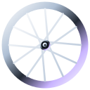

# 🚲 Long Beach Bike Club

A local bike club for Long Beach, NY. **Ride together. Check the weather. Roll out.** `#longbeachny #bikeclub #socialcycling`

## 🏠 Current site: v1.2.0
🚲 **Live:** [sukonik.github.io/lbbikeclub](https://sukonik.github.io/lbbikeclub/) · 🌤️ [Ride weather](https://sukonik.github.io/lbbikeclub/weather.html) · 🚀 [Deploy workflow](https://github.com/Sukonik/lbbikeclub/actions/workflows/pages.yml) · 🧪 [QA workflow](https://github.com/Sukonik/lbbikeclub/actions/workflows/qa.yml)

Pearlescent chrome on black, a deep-section wheel logo, a clean themed header with its own right-side drawer, a live weather chip, and a ride-weather page built for cyclists. Older versions are logged at the [bottom of this README](#-site-version-history).

**Key pages:** [Home](https://sukonik.github.io/lbbikeclub/) · [About](https://sukonik.github.io/lbbikeclub/#about) · [Social Media](https://sukonik.github.io/lbbikeclub/#social) · [Partners](https://sukonik.github.io/lbbikeclub/#partners) · [Locations](https://sukonik.github.io/lbbikeclub/#locations) · [Weather](https://sukonik.github.io/lbbikeclub/weather.html)

## 🌐 Find the club
- Instagram: [@lbbikeclub](https://www.instagram.com/lbbikeclub/) (76 followers, 29 following)
- Facebook: [Long Beach Bike Club](https://www.facebook.com/groups/676497260309868/), a private group with 142 members
- Partner: [Bike Nassau](https://www.instagram.com/bikenassau/)

Counts are a snapshot from Oct 2026. Update them in `index.html`.

## 🧭 Website navigation
Home · About · Social Media · Partners · Locations · Weather. Desktop shows the links in the header. On every screen size the menu button opens the drawer, which holds the links, the theme picker and shortcuts.

## 🎨 Themes
Eight pearlescent themes named for bike brands, switchable from the header dot or the drawer. The choice is saved in the browser and applied before first paint.

| Theme | Color | Theme | Color |
| --- | --- | --- | --- |
| Giant | Black (default) | Scott | Orange |
| Trek | Red | Cervélo | Yellow |
| Specialized | Silver | Cannondale | Blue |
| Canyon | Green | Bianchi | Purple |

Each theme sets three colors (`--a` primary, `--b` color-flip highlight, `--c` deep) in `css/site.css`. The paint background, header tint, drawer, panels, buttons and the wheel all read from them, so everything matches. To add a theme, add one `[data-theme]` rule and one entry in `js/theme.js`.

## 🌤️ Ride weather
[weather.html](https://sukonik.github.io/lbbikeclub/weather.html) uses the free [Open-Meteo](https://open-meteo.com/) API (no key) and pairs with the full [ClearSky weather app](https://sukonik.github.io/weather-app/) ([source](https://github.com/Sukonik/weather-app)) for tides, air quality, wind charts, UV and moon phases.
- **Ride score** (0–100): our own estimate from feels-like temperature, wind, gusts, rain chance, UV and daylight. A guide, not a safety guarantee.
- **Wind compass** with headwind, tailwind and crosswind for the direction you pick.
- **Bike-computer tiles**, a **best two-hour window**, a **24-hour tread-bar strip** and a **7-day outlook**.
- **What to wear** and **lights and daylight** guidance.
- Eight ride areas (Long Beach, Point Lookout, Lido Beach, Atlantic Beach, Rockaway Beach, Arverne, Lawrence, Cedarhurst) and °F/mph or °C/km/h.
- A live chip in the header and live readouts on the home page use the same data (cached 10 minutes).

## 🧩 UI/UX architecture
**What we use right now.** A static site: plain HTML, CSS and JavaScript. No framework, no build step, no runtime dependencies, so it deploys straight to GitHub Pages.

| Layer | What we use today |
| --- | --- |
| **Visual direction** | Black first, pearlescent color second, white text. The modular, high-contrast look of [Anduril](https://www.anduril.com/) with Y2K chrome: glassy panels, chrome-gradient headings, a chrome wheel, soft color-flip "pearl paint" behind everything. |
| **Theme system** | 8 bike-brand themes (see [Themes](#-themes)) driven by three CSS color tokens: `--a`, `--b`, `--c`. Registered with `@property`, so color changes animate smoothly. Saved in `localStorage`, applied before first paint. |
| **Logo and icons** | A flat, bright 2D wheel: rim, 16 crossing spokes and a hub. No tire, no outer line, no gradients, so it reads at small sizes. It stays bright white and takes only a slight tint (16%) from the active theme, as does the tab icon. The same mark is the header logo (56 px), the spinning hero wheel and the icons. The favicon is a bolder 12-spoke version so it reads at 16 px. Generated by `scripts/build_icons.js`. |
| **Header** | Clean near-black bar tinted by the theme, a 1px theme-colored hairline, large wheel logo, desktop link row, live weather chip, theme orb, menu button. Sticky with blur. Icon buttons are fixed-size circles with centered SVG icons; letter-spaced button labels are optically centered. |
| **Drawer** | Its own surface on the right: darker panel, theme-colored edge, scrim. Holds navigation, the theme picker and shortcuts. Escape closes it, Tab stays inside it, focus returns to the button. |
| **Typography** | [Inter](https://fonts.google.com/specimen/Inter) for text and headings (system fallbacks), a system monospace for labels, numbers and the bike-computer readouts. Display headings are uppercase, heavy, tightly tracked. |
| **Layout** | Mobile first, 640 / 920 / 1200 px breakpoints, `min(100% - 2rem, 80rem)` container, CSS Grid for panels and the weather dashboard. No horizontal scroll at 320 px and up. |
| **Components** | Panel (pearl glass card), button (chrome and outline), badge, select, segmented control, toggle group, tabs, progress segments, checklist, gauge, compass. All hand-written in `css/site.css` and `css/weather.css`. |
| **Bike UI elements** | Ride-score speedometer gauge, wind compass with rider heading, bike-computer tiles with LED segment bars, tire-tread hourly bars, spinning chrome wheel on the home page. |
| **Motion** | Slow paint drift, wheel spin, soft reveal on scroll, count-up numbers, gauge and compass easing. All off under `prefers-reduced-motion`. |
| **Accessibility** | Skip link, visible focus rings, semantic landmarks, `aria` on drawer, tabs, toggle buttons and the live weather region, text contrast on dark, keyboard operable everywhere. |
| **Data** | [Open-Meteo](https://open-meteo.com/) (no API key), cached 10 minutes in `sessionStorage`, with an error and retry state. |
| **Quality checks** | `tests/check_site.py` (links, anchors, files, SEO) before every deploy; `tests/browser_check.js` (3 pages x 5 widths, drawer, all themes, weather render) on pull requests. |

**Where the ideas come from.** The structure and responsive patterns follow [GoldenSunLaw](https://github.com/Sukonik/GoldenSunLaw) and [GoldBrief](https://github.com/Sukonik/goldbrief). Component patterns are borrowed from [Ant Design](https://github.com/ant-design/ant-design) (segmented control), [Base UI](https://github.com/mui/base-ui) (toggle group, accessible drawer behavior), [shadcn/ui](https://github.com/shadcn-ui/ui) (select, tabs, badge) and [Chakra UI](https://github.com/chakra-ui/chakra-ui) (spacing and token ideas). Those projects are React libraries, so we rewrite the patterns as small vanilla CSS and JS rather than install them. **We do not ship any of their code.** If we ever copy code, check that project's license first.

**Design rules.**
1. One source of color: every surface reads `--a`, `--b`, `--c`. Never hard-code a theme color.
2. White text on dark. Color is for accents, edges, glow and data.
3. Short copy. Labels in mono, headings in Inter.
4. Motion is slow and optional.

## 🗂️ Structure
```
index.html, weather.html, 404.html     pages
css/site.css                           tokens, themes, header, drawer, panels
css/weather.css                        ride-weather components
js/theme.js                            theme list, saved choice (loaded in <head>)
js/weather-lib.js                      Open-Meteo, ride score, units, header chip
js/weather-page.js                     weather page renderers and controls
js/main.js                             drawer, reveal, active nav
assets/                                wheel logo, favicons, app icons, share image
scripts/build_icons.js                 generates the wheel mark and icons (`--symbol` prints the inline mark)
robots.txt, sitemap.xml, site.webmanifest
tests/                                 check_site.py, browser_check.js, mock_weather.js
.github/workflows/                     pages.yml (deploy), qa.yml (PR checks)
```

## ✏️ Editing content
- Partners live in `#partners` and towns in `#locations` in `index.html`.
- Ride times are not listed. They are posted in the Facebook group. Add a schedule to `#about` when you have one.
- Ride areas are listed in `js/weather-lib.js` (`PLACES`).
- Add a custom domain by creating a `CNAME` file in the repo root.

## 🧪 Testing
```bash
python3 tests/check_site.py            # links, anchors, files, SEO basics (no dependencies)
python3 -m http.server 8123 &          # serve the site
npm i --no-save playwright && npx playwright install chromium
node tests/browser_check.js            # 3 pages x 5 widths: overflow, JS errors, drawer, all 8 themes, weather render
```
`browser_check.js` mocks the weather API, so it runs offline. The pull-request workflow (`qa.yml`) runs all of this. Automated checks do not replace human visual review.

## 🚀 Deployment and publishing
Automatic. Every push to `main` runs [`pages.yml`](.github/workflows/pages.yml): static checks first, then deploy to GitHub Pages. Pull requests run checks only. One-time setup: **Settings > Pages > Source: GitHub Actions**. Redeploy by hand from **Actions > Deploy GitHub Pages > Run workflow**. Preview locally with `python3 -m http.server`.

## 🗺️ Roadmap
- **1.2** real ride schedule, photos, and a partner list.
- **1.3** route pages with map links and wind-aware route suggestions.
- **2.0** events calendar and member features, if the club wants them.

## 📜 License
[Mozilla Public License 2.0](LICENSE).

## 🕰️ Site version history
Newest version is shown at the [top](#-current-site-v120); this log lists every version, newest first. **Maintenance rule:** when the site changes in a user-visible way, move the previous "Current" entry here, add the new one at the top, and add a matching [CHANGELOG](CHANGELOG.md) entry.

| Version | Date | Status | Summary |
| --- | --- | --- | --- |
| 1.2.0 | 2026-10-28 | **Current** (see top) | Simple flat wheel logo and favicon (rim and spokes only, bright white with a slight theme tint), larger header logo, mobile polish: centered menu icon, theme orb and button labels, tidier button rows, hero readouts moved off the wheel. |
| 1.1.0 | 2026-10-28 | Superseded | 8 pearlescent bike-brand themes and switcher, themed header and right-side drawer, live weather chip, Ride Weather page (score gauge, wind compass, best window, 24-hour and 7-day, what to wear, lights), scrolling text bar removed, tighter copy, browser QA, README and CHANGELOG in GoldBrief style. |
| 1.0.0 | 2026-10-28 | Superseded | First public release ([`2848799`](https://github.com/Sukonik/lbbikeclub/commit/2848799), [PR #1](https://github.com/Sukonik/lbbikeclub/pull/1)): Home, About, Social Media, Partners, Locations; Y2K chrome look on black with cyan accents; automated Pages deploy with pre-deploy checks; 404, sitemap, robots, manifest, share image, structured data. |
| pre-1.0 draft 3 | 2026-10-28 | Never public | Publish automation, 404, sitemap, robots, manifest, share image ([`5c2d27d`](https://github.com/Sukonik/lbbikeclub/commit/5c2d27d)). |
| pre-1.0 draft 2 | 2026-10-28 | Never public | Social Media, Partners (Bike Nassau) and Locations sections for 8 towns ([`1fba65c`](https://github.com/Sukonik/lbbikeclub/commit/1fba65c)). |
| pre-1.0 draft 1 | 2026-10-28 | Never public | First single-page Y2K chrome site with spinning wheel, About, Rides and Join ([`a25829e`](https://github.com/Sukonik/lbbikeclub/commit/a25829e)). |

Drafts are listed from branch history before launch. Exact earlier states can be viewed with `git show <commit>:index.html`.
